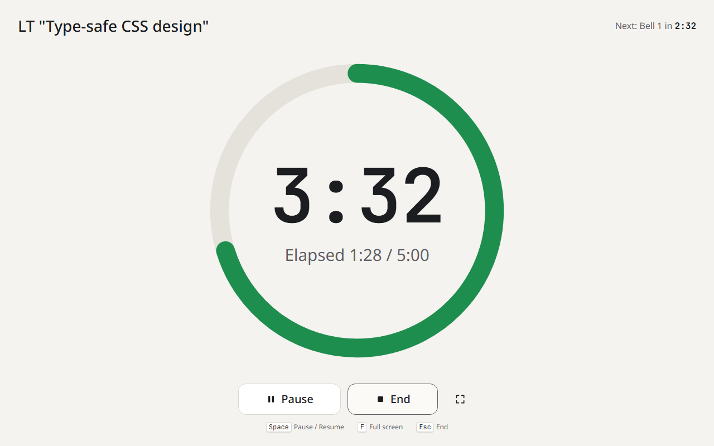

[日本語](README.md) | English | [简体中文](README.zh-Hans.md)

# LT Timekeeper

A timer that runs in your browser, for keeping time at lightning talks and presentations. It shows the remaining time so that it can be read at a glance, even from the back of the room.

**Use it:** https://lt.rinontech.com/ (no sign-up needed)

## Features

- Shows the remaining time as a large number inside a ring. Three stages — normal (green), warning (yellow) and overtime (red) — are conveyed not only by color but also by the ring's fill and a status label
- Rings a bell at the moments you choose, in the Japanese conference style of 1, 2 and 3 rings. You can add, edit and delete bells freely. On devices that support it, the device vibrates along with the bell
- Doesn't stop when time runs out. It counts the overtime upward with a "+" sign
- Available in Japanese, English and Simplified Chinese. It starts in your device's language, and you can switch at any time
- Installable as a PWA, and works offline from the second visit on

## How to use

1. Enter the time limit in minutes and seconds, or pick a preset (3, 5, 10, 15 or 20 minutes). If you like, set the bells and a display title
2. Press "Start" and the timer begins at once
3. While timing, you can use these keys. The buttons hide automatically when there is no activity (move the mouse or tap to bring them back)
   - `Space`: pause / resume
   - `F`: full screen
   - `Esc`: end (asks for confirmation)
4. "End" takes you back to the settings screen. The time limit, bells and display title stay as you left them

The gear button at the top right opens the preferences: language, theme, volume, vibration and more.

To install it as a PWA, use the install button that Chrome or Edge shows in the address bar.

## Supported environments

- Main target: the latest Chrome (Windows, macOS, Android)
- Also works on the latest Edge
- On iOS Safari, the display and timing work. Vibration and full screen are not available
- Works from a smartphone (390 px wide) up to a large screen connected to a projector
- **Only the first launch needs an internet connection.** This is to load the fonts; once loaded, they are shown the same way offline from the second visit on. If the first launch is offline, the fonts are simply replaced by standard ones, and you can still start and time a talk

## Privacy

- It collects no personal information and no usage data. There are no accounts, analytics tools, ads or tracking cookies
- What it saves on your device is only five preferences (language, theme, volume, vibration and the end confirmation). They are kept in the browser's `localStorage` and disappear if you clear this site's data in the browser. The time limit, bells and display title are not saved
- It never sends the saved values or what you type anywhere. The only external communication is loading the fonts from Google Fonts. When that happens, your browser's connection information (such as your IP address) reaches Google. How Google handles it is governed by Google's own policies
- It doesn't use any feature that asks for permission, such as the camera, microphone, location or notifications

You can read the same content in the app, under Preferences → About → Privacy policy.

## Changelog and license

- The history of changes is in [CHANGELOG.md](CHANGELOG.md) (in Japanese)
- Licensed under the [Apache License 2.0](LICENSE)
- To report a problem or contribute, see [CONTRIBUTING.md](CONTRIBUTING.md) (in Japanese)
