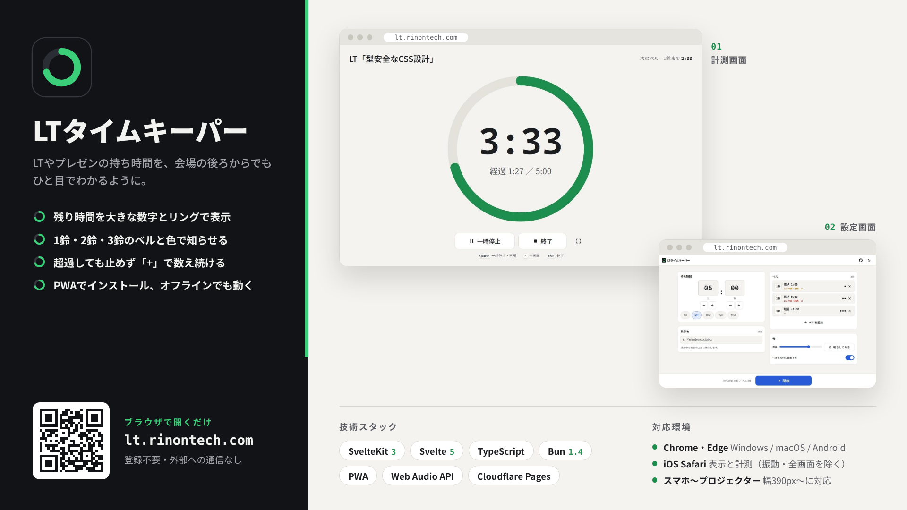

# LTタイムキーパー

ライトニングトークなどの持ち時間を計るタイマーです。ブラウザで動き、PWA としてインストールしてオフラインでも使えます。

公開先: https://lt.rinontech.com/

開発・ビルド・リリースの手順は [CONTRIBUTING.md](CONTRIBUTING.md) を参照してください。

## ドキュメント

- `docs/brand/`: ブランド資料とマスターSVG
- `roadmap/`: 仕様・設計・実装計画・検証の記録

## ライセンス

[LICENSE](LICENSE) を参照してください。
