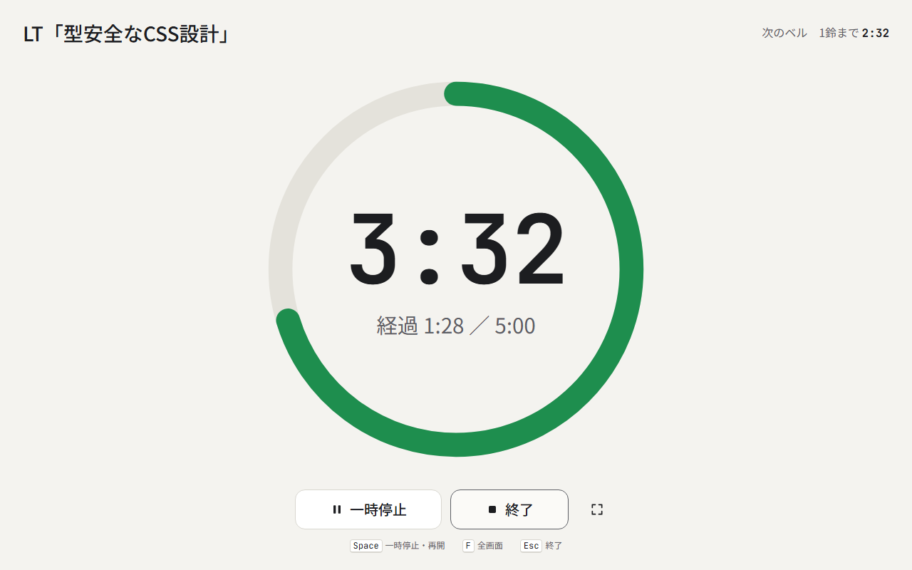

日本語 | [English](README.en.md) | [简体中文](README.zh-Hans.md)

# LTタイムキーパー

ライトニングトーク（LT）やプレゼンテーションの持ち時間を計る、ブラウザで動くタイマーです。残り時間を、会場の後ろからでも一目でわかるように示します。

**使う:** https://lt.rinontech.com/ （登録は不要です）

## 特徴

- 残り時間を、大きな数字とリングで示します。通常（緑）・予鈴（黄）・超過（赤）の3段階を、色だけでなく、リングの残量と状態の表示でも伝えます
- 1鈴・2鈴・3鈴のように、決めた時点でベルを鳴らします。ベルは自由に追加・編集・削除できます。対応する端末では、同時に振動もします
- 時間を過ぎても止まらず、超過した時間を「+」付きで数え上げます
- 日本語・English・简体中文に対応しています。端末の言語に合わせて始まり、いつでも切り替えられます
- PWA としてインストールでき、2回目以降はオフラインでも使えます

## 使い方

1. 持ち時間を、分・秒で入力するか、プリセット（3・5・10・15・20 分）から選びます。必要なら、ベルと表示名を設定します
2. 「開始」を押すと、すぐに計測が始まります
3. 計測中は、次のキーで操作できます。操作がないと、ボタンは自動で隠れます（マウスを動かすかタップすると戻ります）
   - `Space`：一時停止・再開
   - `F`：全画面表示
   - `Esc`：終了（確認が出ます）
4. 「終了」で設定の画面に戻ります。持ち時間・ベル・表示名は、そのまま残ります

画面右上の歯車ボタンから、言語・表示テーマ・音量・振動などを設定できます。

PWA としてインストールするには、Chrome や Edge のアドレスバーに出るインストールのボタンを使います。

## 対応環境

- 主な対象：Chrome（Windows・macOS・Android）の最新版
- Edge の最新版でも動きます
- iOS Safari では、表示と計測が動きます。振動と全画面表示は使えません
- スマートフォン（幅 390px）から、プロジェクターにつないだ大きな画面まで使えます
- **初回の起動だけは、インターネットへの接続が必要です。** 書体を読み込むためで、一度読み込めば、2回目以降はオフラインでも同じ書体で表示します。初回がオフラインでも、書体が標準のものに置き換わるだけで、起動と計測はできます

## プライバシー

- 個人情報も利用状況も集めません。アカウント、解析ツール、広告、追跡用の Cookie はありません
- 端末に保存するのは、環境設定の5項目（言語・表示テーマ・音量・振動・終了の確認）だけです。ブラウザの `localStorage` に置き、ブラウザでこのサイトのデータを消すと消えます。持ち時間・ベル・表示名は保存しません
- 保存した値や入力した内容を、外部へ送ることはありません。外部への通信は、書体を Google Fonts から読み込むときだけです。その際、ブラウザの接続情報（IP アドレスなど）が Google に届きます。Google 側の扱いは、Google のポリシーによります
- カメラ・マイク・位置情報・通知など、許可を求める機能は使いません

アプリの中の「環境設定」→「アプリ情報」→「プライバシーポリシー」でも、同じ内容を読めます。

## 更新履歴・ライセンス

- 変更の履歴は [CHANGELOG.md](CHANGELOG.md) にあります
- ライセンスは [Apache License 2.0](LICENSE) です
- 不具合の報告や開発に参加する方は、[CONTRIBUTING.md](CONTRIBUTING.md)（日本語）を参照してください
