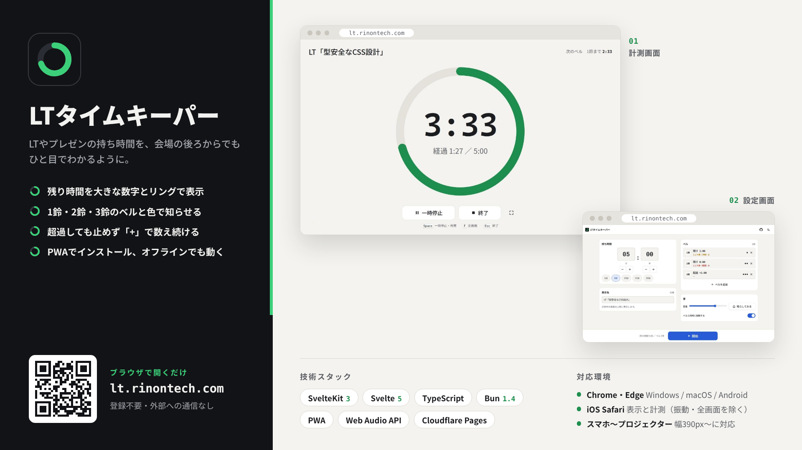

# LTタイムキーパー



ライトニングトークなどの持ち時間を計るタイマーです。ブラウザで動き、PWA としてインストールしてオフラインでも使えます。

公開先: https://lt.rinontech.com/

## 必要なもの

- [Bun](https://bun.sh/) 1.4.x

## 開発

```sh
bun install
bun run dev
```

## 確認

```sh
bun run check:tokens   # トークンの一致と、色・寸法の直書きがないことを検査
bun run check          # 型検査（svelte-check、Service Worker の tsc）
bun run test:unit      # 単体テスト（Vitest。監視モード。1回だけなら末尾に --run）
bun run test           # 単体テスト（1回）と e2e（Playwright）
```

`bun run test` の e2e は、実行前に Playwright のブラウザを入れ、ビルドしてプレビューを起動します。

## ビルド

```sh
bun run build     # 静的サイトを build/ に出力
bun run preview   # build/ をローカルで確認
```

## アイコン生成

アイコン一式・OGP 画像・`manifest.webmanifest` は、`roadmap/specs/` の最新版のマスターSVGとトークンから生成します。

```sh
bun run gen:icons
```

出力は `static/icons/` と `static/manifest.webmanifest` で、生成物はリポジトリに含めます（CI では生成しません）。マスターSVGやトークンを更新したときに実行し、`app.html` の `theme-color` も合わせて確認してください。

## リリース

`v*` タグを push すると、GitHub Actions が検査とビルドを通し、`build/` の zip を添付したドラフトリリースを作ります。変更履歴は [CHANGELOG.md](CHANGELOG.md) に記録します。公開先へのデプロイは Cloudflare Pages の GitHub 連携で行います。

## ドキュメント

- `docs/brand/`: ブランド資料とマスターSVG
- `roadmap/`: 仕様・設計・実装計画・検証の記録

## ライセンス

[LICENSE](LICENSE) を参照してください。
