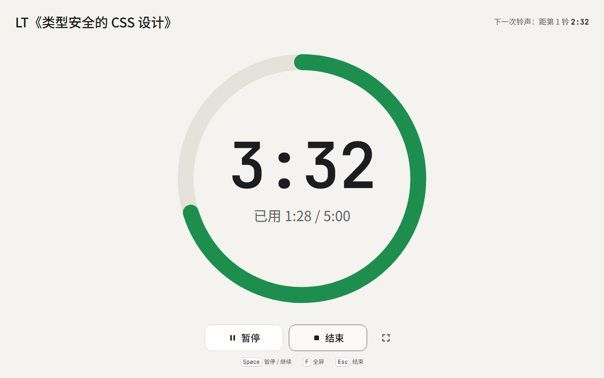

[日本語](README.md) | [English](README.en.md) | 简体中文

# LT 计时器

一款在浏览器中运行的计时器，用于控制闪电演讲（LT）和演示的时间。即使坐在会场最后排，也能一眼看清剩余时间。

**立即使用：** https://lt.rinontech.com/ （无需注册）

## 特点

- 用大号数字和圆环显示剩余时间。正常（绿）、预警（黄）、超时（红）三个阶段，除了颜色之外，还通过圆环的剩余量和状态标签来传达
- 在设定的时间点响铃，沿用日本学会和 LT 中“1 铃、2 铃、3 铃”的习惯。铃声可以自由添加、编辑和删除。在支持的设备上，还会同时振动
- 时间到了也不会停止，会以带“+”的形式继续累计超时时间
- 支持日语、English 和简体中文。首次打开时会按设备语言显示，之后可随时切换
- 可作为 PWA 安装，第二次起即使离线也能使用

## 使用方法

1. 以分、秒输入限定时间，或从预设（3、5、10、15、20 分钟）中选择。需要的话，可以设置铃声和显示标题
2. 点击“开始”，计时立即开始
3. 计时过程中可以使用以下按键。一段时间没有操作，按钮会自动隐藏（移动鼠标或点按屏幕即可重新显示）
   - `Space`：暂停 / 继续
   - `F`：全屏显示
   - `Esc`：结束（会先请求确认）
4. 点击“结束”回到设置界面。限定时间、铃声和显示标题会保持原样

点击右上角的齿轮按钮，可以设置语言、显示主题、音量、振动等。

要作为 PWA 安装，请使用 Chrome 或 Edge 地址栏中出现的安装按钮。

## 支持的环境

- 主要对象：最新版 Chrome（Windows、macOS、Android）
- 最新版 Edge 也可以使用
- 在 iOS Safari 上，显示和计时可以正常使用，但无法使用振动和全屏显示
- 从智能手机（宽 390px）到连接投影仪的大屏幕，都可以使用
- **只有第一次启动需要连接互联网。** 这是为了加载字体；加载一次之后，第二次起即使离线，也会以相同的字体显示。如果第一次启动时处于离线状态，字体只会被替换为标准字体，仍然可以启动和计时

## 隐私

- 不收集个人信息，也不收集使用情况。没有账号、分析工具、广告和追踪用的 Cookie
- 保存在设备上的，只有偏好设置的 5 项（语言、显示主题、音量、振动、结束确认）。它们保存在浏览器的 `localStorage` 中，在浏览器里清除本网站的数据后就会消失。限定时间、铃声和显示标题不会被保存
- 不会把保存的值或输入的内容发送到任何地方。对外通信只有从 Google Fonts 加载字体这一项，此时浏览器的连接信息（如 IP 地址）会到达 Google。Google 如何处理这些信息，取决于 Google 自己的政策
- 不使用摄像头、麦克风、位置信息、通知等需要请求授权的功能

在应用内的“偏好设置”→“关于”→“隐私政策”中，也可以阅读相同的内容。

## 更新记录与许可证

- 更新记录见 [CHANGELOG.md](CHANGELOG.md)（日语）
- 许可证为 [Apache License 2.0](LICENSE)
- 如需报告问题或参与开发，请参阅 [CONTRIBUTING.md](CONTRIBUTING.md)（日语）
